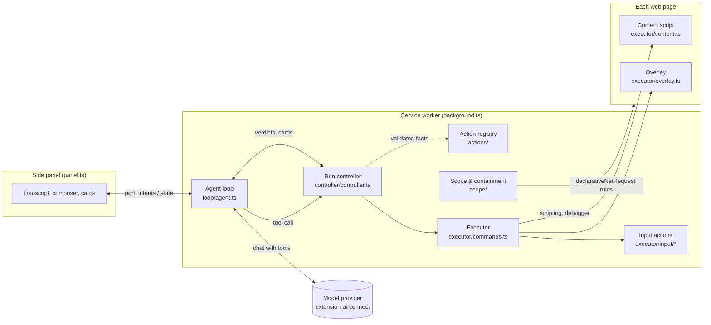

# Architecture

Valet is a Chrome extension (Manifest V3) with no server. A model of the
owner's choosing proposes browser actions; the extension decides whether each
one may run, runs it in the owner's own tabs, and shows the owner every step.
This page is about how that is put together and what it guarantees.

## The pieces

| Layer | Owns | Does not |
| --- | --- | --- |
| **Panel** (`panel.ts`) | Rendering the conversation, the composer, approval cards; sending the owner's intents. | Run any agent logic. It is a view over state the worker pushes. |
| **Agent loop** (`loop/agent.ts`) | One run: goal → model turn → tool calls in order → results back, until the model answers. Budgets, Stop, persistence, Learn's step-by-step, the owner's approvals for the conversation. | Touch the browser. Every tool call goes to the controller. |
| **Action registry** (`actions/`) | The browser tool's contract: one spec per action — its fields, rules, safety facts, guidance for the model, and wording for the owner. The validator, the JSON Schema, the tool description and the step wording are generated from it. | Decide anything. Specs describe; the controller enforces. |
| **Run controller** (`controller/controller.ts`) | The one door every action goes through, in a fixed order (below). Classifying every failure by whether anything was dispatched. | Know how Chrome is driven. |
| **Executor** (`executor/commands.ts`) | Sessions and tabs, observation, screenshots, the debugger, persistence across worker restarts. | Decide whether an action may run. |
| **Input actions** (`executor/input/*`) | How a click, a key, a drag or a scroll is made — through the debugger, or the page's own events where it cannot reach. | Reach anything of the executor beyond the `Driver` interface (`executor/driver.ts`). |
| **Page side** (`executor/content.ts`, `page.ts`, `overlay.ts`) | Reading the page as an accessibility tree with refs; locating an element by ref; telling what a form would submit; the halo, cursor and step bubble. | Exist in the page's own world: it lives in the extension's isolated world, out of the page's reach. |
| **Scope** (`scope/`) | Which sites the conversation may reach, and network rules that block the rest before a request leaves the browser. | Depend on the model behaving. |

## One action, start to finish

Every tool call takes the same path through `RunController.run()`:

1. **Guards.** A stopped or paused run skips the call: nothing is dispatched.
2. **Validate.** `commandSchema` (generated from the registry) rejects a
   malformed call, saying what to send instead. Three in a row pause the run:
   the model is not forming commands.
3. **Evidence.** An acting action must name the latest observation's id, and
   its target must be a ref from that observation. Anything older is refused,
   with a fresh observation attached.
4. **Aim.** A point on a screenshot is mapped to the viewport and resolved to
   the element there, so it is checked like a ref. A point on a part of the
   page painted over (another site's frame) is refused.
5. **Scope.** If the action's facts say it goes somewhere — a URL, a link it
   would follow — that site must be approved for the conversation; otherwise
   the owner gets a card. A denial is final for that call.
6. **Form check.** If the action could submit a form (`submits` fact), the
   page side reads exactly what would be sent; the owner approves that
   destination and those values. After approval the facts are read again; if
   anything changed, the owner is asked again.
7. **Dispatch.** The latest observation is invalidated, then the executor
   runs the command.
8. **Observe.** Every result carries a fresh observation, so the model never
   acts on a page it has not seen.

## What a result means

The controller classifies every outcome by whether dispatch had begun — read
from the command's `Cancellation`, never guessed from the error:

| Result | Meaning | What the model is told |
| --- | --- | --- |
| `completed: true` | It ran; here is the page now. | Continue from the new observation. |
| `refused` | Nothing was dispatched. | Observe and reconsider; a retry is safe. |
| `completed: "unknown"` | Dispatch had begun when it failed: it may have happened. The run pauses. | Inspect before acting; never repeat a submission. |
| `skipped` | Not run (stopped, paused, or an earlier call in the batch failed). | Nothing happened. |

## Safety guarantees

- **The extension enforces, not the model.** Scope, form approval and fresh
  evidence are checked in code before dispatch. A model told by a page to go
  elsewhere still meets the same checks.
- **Facts are mandatory.** Every action states whether it goes to a URL,
  follows a link or can submit a form — `INERT` when it does none of these.
  Leaving a fact out does not compile.
- **Two layers for sites.** Besides the controller's check, `declarativeNetRequest`
  rules block requests to unapproved sites from the conversation's tabs at the
  network level, including redirects and page-initiated navigations.
- **Untrusted content stays untrusted.** Page text and images reach the model
  marked as evidence, never instructions; text from frames of unapproved
  sites is withheld, and those frames are painted over in screenshots.
- **Passwords are never typed** by the agent; a password field refuses `fill`.
- **Nothing is kept beyond the conversation** except the owner's own settings
  and skills; approvals end with the conversation.

## Adding an action

1. Write `src/actions/<name>.ts`: an `ActionSpec` with its fields, rules,
   `facts` (all three stated), `guide` and `step`. Add its name to
   `ACTION_NAMES` and its spec to `SPECS` in `index.ts` — the types make a
   missing entry a compile error.
2. New fields go in `src/actions/fields.ts`, with their validator and JSON
   Schema.
3. If it acts on the page, write `src/executor/input/<name>.ts` against the
   `Driver` and add it to `INPUT`; a test holds `INPUT` to the registry's
   acting actions. Otherwise handle it in the executor's dispatch.
4. Run `npm test`. The golden files under `src/actions/golden` show exactly
   what the model and the owner will read differently; commit them with the
   change. Run `npm run docs` to regenerate [actions.md](actions.md).

## Tests

| Suite | What it proves |
| --- | --- |
| `src/actions/*.test.ts` | The registry is coherent; the wire schema and the validator agree; golden files freeze what the model and owner read. |
| `src/controller/*.test.ts` | Every failure class and every safety check, against a scripted executor. |
| `src/executor/*.test.ts` | The executor against a fake `chrome`: refs, frames, the debugger, masking, persistence. |
| `src/loop/*.test.ts` | The agent loop with a scripted model: one result per call, budgets, Stop, restarts, Learn. |
| `e2e/*.spec.ts` | The built extension in Chromium, driven by a scripted model against a fixture site: the whole path, cards included. |

`npm run screenshots` renders every screen and state of the UI, light and
dark, from the same fixtures.
